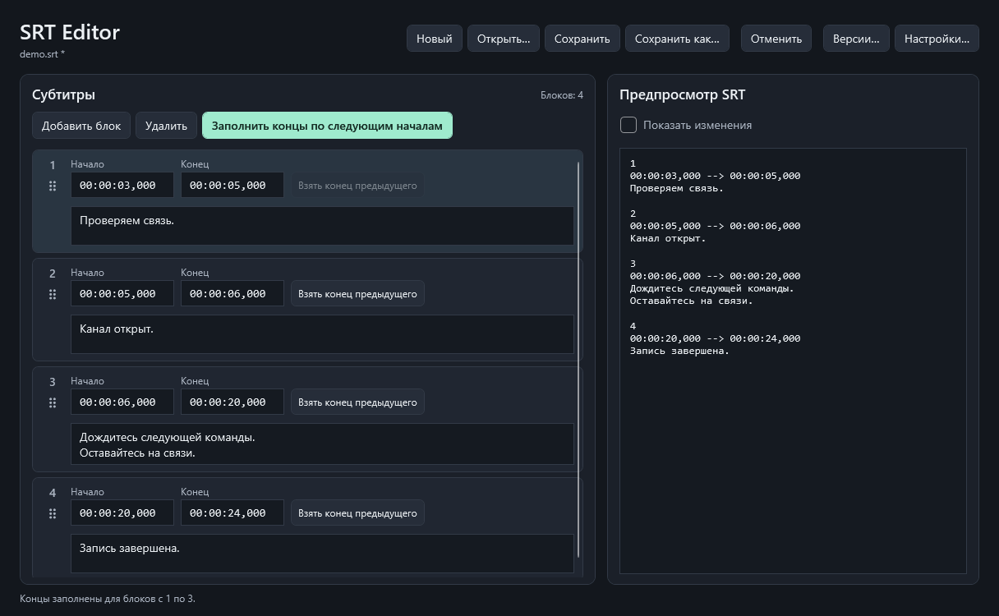
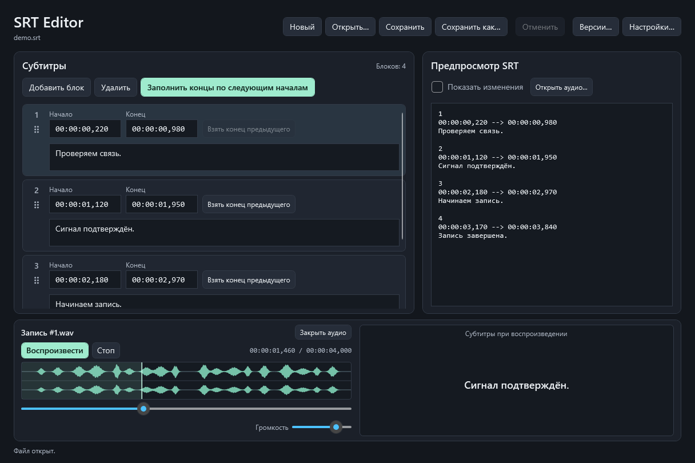
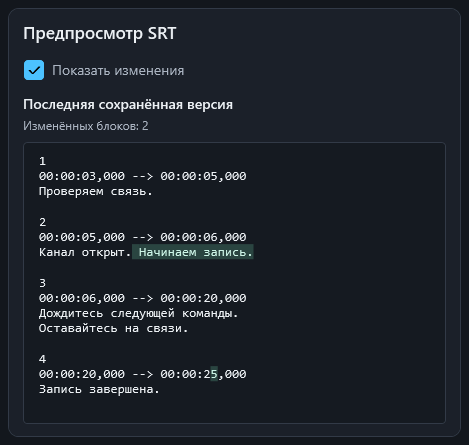
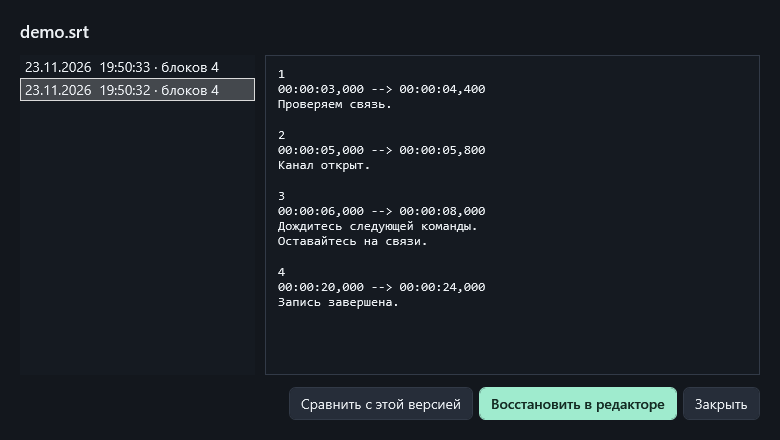

# SRT Editor

SRT Editor — настольное приложение для Windows для ручной расстановки субтитров и редактирования файлов `.srt`. В левой части окна находятся блоки с текстом и таймингами, в правой — предпросмотр SRT, который обновляется по мере редактирования. Приложение написано на C# с WPF и .NET 10.



- [Запуск](#запуск)
- [Редактирование субтитров](#редактирование-субтитров)
- [Быстрая расстановка таймингов](#быстрая-расстановка-таймингов)
- [Прослушивание и проверка субтитров](#прослушивание-и-проверка-субтитров)
- [Предпросмотр и история версий](#предпросмотр-и-история-версий)
- [Горячие клавиши](#горячие-клавиши)
- [Формат и кодировки](#формат-и-кодировки)
- [Сборка из исходников](#сборка-из-исходников)
- [Устройство проекта](#устройство-проекта)

## Запуск

Готовая автономная сборка для Windows x64 включает среду .NET. Откройте `SrtEditor.exe` или EXE с номером версии в имени в папке `bin\windows-x64`. Для создания истории приложению нужен доступ на запись в папку рядом с EXE.

Если у вас есть исходники, получить EXE можно командой из раздела [Сборка из исходников](#сборка-из-исходников).

## Редактирование субтитров

1. Нажмите **«Открыть…»** и выберите `.srt`. Для нового файла нажмите **«Новый»**.
2. В каждом блоке можно изменить поля **«Начало»** и **«Конец»** и ввести многострочный текст.
3. **«Добавить блок»** вставляет реплику после выбранной, а при отсутствии выбора — в конец списка. **«Удалить»** убирает выбранный блок.
4. Чтобы переставить реплику, перетащите её за ручку слева от полей. Вместе с текстом перемещаются начало и конец, а номера пересчитываются по порядку списка.
5. Нажмите **«Сохранить»** или **«Сохранить как…»**. Звёздочка рядом с именем помечает несохранённые изменения. При закрытии или смене документа редактор предложит их сохранить.

Сохранение требует заполнить текст и оба тайминга в каждом блоке. Конец должен быть позже начала. Пересекающиеся интервалы помечаются предупреждением и допускаются при сохранении.

## Быстрая расстановка таймингов

Вводите время в секундах (`5`, `5.250` или `5,250`) либо в формате SRT (`00:00:05,250`). Точность ввода — до миллисекунды. В файле пять с четвертью секунд записываются как `00:00:05,250`.

### Заполнить концы по началам реплик

1. Создайте блоки и введите время начала каждой реплики в порядке списка. Из поля **«Начало»** клавиша `Enter` переводит в начало следующего блока, а в последнем блоке — в его поле **«Конец»**.
2. Введите конец последней реплики вручную.
3. Нажмите **«Заполнить концы по следующим началам»**. Конец каждого блока до последнего станет равен началу следующего. Результат сразу появится в предпросмотре.
4. При необходимости поправьте отдельные концы вручную, чтобы оставить паузы.

Например, для начал `3`, `5`, `6`, `20` и последнего конца `24` получится следующий SRT.

```srt
1
00:00:03,000 --> 00:00:05,000
Первая реплика.

2
00:00:05,000 --> 00:00:06,000
Вторая реплика.

3
00:00:06,000 --> 00:00:20,000
Третья реплика.
Продолжение в той же реплике.

4
00:00:20,000 --> 00:00:24,000
Последняя реплика.
```

Для массового заполнения нужны корректные, строго возрастающие начала. Если начало пропущено, введено с ошибкой или два соседних начала нарушают этот порядок, редактор укажет, где исправить тайминг. Расчёт концов выполняется одной операцией после проверки и отменяется одним нажатием `Ctrl+Z`.

### Подставить конец предыдущей реплики

Нажмите **«Взять конец предыдущего»** в нужном блоке. Например, если предыдущая реплика заканчивается в `10` секунд, текущая получит начало `00:00:10,000`. Команда работает с полем **«Начало»** выбранного блока.

## Прослушивание и проверка субтитров

1. Нажмите **«Показать аудио»** внизу окна. Щёлкните по области **«Нажмите, чтобы открыть аудио»** или по кнопке **«Открыть аудио…»** и выберите файл, например WAV, MP3 или OGG.
2. Нажмите **«Воспроизвести»**. Текущие реплики появятся в области **«Субтитры при воспроизведении»** внизу окна. В паузах между репликами область пустая, а пересекающиеся реплики видны одновременно.
3. Нажмите на волну или ползунок и перетащите курсор к нужному моменту. Субтитры сразу обновятся. Кнопка **«Пауза»** удерживает текущую позицию, **«Стоп»** возвращает к началу файла.
4. Поправьте тайминги или текст и проверьте результат сразу. Область воспроизведения использует открытый документ со всеми несохранёнными правками.

Перетащите разделитель над панелью, чтобы изменить её высоту. **«Скрыть аудио»** сворачивает панель, а повторное открытие возвращает выбранный размер в текущем окне.

Для точной перемотки дважды щёлкните по текущему времени плеера. Введите секунды, например `12.345`, или полное время `00:00:12,345`. Нажмите `Enter` для перехода или `Esc` для отмены.



Стереофайл отображается двумя дорожками волны, монофайл — одной. Вертикальная линия отмечает текущую позицию. Кнопка **«Закрыть аудио»** освобождает звуковой файл.

Для OGG встроены декодеры Vorbis и моно/стерео Opus. Воспроизведение доступно после подготовки первых фрагментов. Остальная запись декодируется в фоне вместе с построением волны. При переходе к участку, который ещё декодируется, звук начинается, когда этот участок будет готов.

Для остальных форматов воспроизведение и построение волны зависят от доступных в Windows декодеров. Для форматов, где доступно только воспроизведение, пользуйтесь ползунком.

## Предпросмотр и история версий

### Посмотреть изменения и вернуть один блок

Флажок **«Показать изменения»** над предпросмотром включён при запуске. По умолчанию сравнение идёт с последним сохранением. Добавленные и заменённые фрагменты подсвечиваются в строке, удалённые — зачёркиваются. У перемещённой реплики выделяется номер.



Щёлкните правой кнопкой по изменённому блоку и выберите **«Вернуть блок из версии»**. Для добавленной реплики используйте **«Убрать добавленный блок»**. Откат одного блока можно отменить через `Ctrl+Z`. Для копирования чистого SRT снимите галочку **«Показать изменения»**.

### Сравнить или восстановить целую версию

1. Нажмите **«Версии…»**. Окно показывает дату, время и число блоков каждого снимка, а справа отображается содержимое выбранного.
2. Нажмите **«Сравнить с этой версией»**, чтобы сделать снимок основой для подсветки. Кнопка **«Сравнить с последней»** возвращает сравнение с последним сохранением.
3. Нажмите **«Восстановить в редакторе»**, чтобы загрузить содержимое выбранной версии в открытый документ. `Ctrl+S` применяет восстановленную версию к файлу на диске, `Ctrl+Z` отменяет восстановление в редакторе.



### Где хранится история

Редактор создаёт локальные снимки при открытии и сохранении SRT. Новый снимок появляется, когда содержимое отличается от последнего снимка для этого пути. История хранится в `cache\versions` рядом с EXE и привязана к полному пути SRT, поэтому переименованный файл или копия в другой папке получают отдельную историю.

Откройте **«Настройки…»**, чтобы посмотреть путь к кэшу. Команда **«Очистить историю…»** после подтверждения удаляет снимки всех файлов из этого кэша.

## Горячие клавиши

| Клавиши | Действие |
| --- | --- |
| `Ctrl+N` | Создать новый документ |
| `Ctrl+O` | Открыть SRT |
| `Ctrl+S` | Сохранить текущий файл |
| `Ctrl+Shift+S` | Сохранить под другим именем |
| `Ctrl+Z` | Отменить последнее действие |
| `Ctrl+Enter` | Добавить блок после выбранного |
| `Enter` в поле «Начало» | Перейти к началу следующего блока или в поле «Конец» в последнем блоке |
| `Enter` в поле текста | Добавить новую строку субтитра |
| `Пробел` вне полей ввода | Запустить аудио или поставить его на паузу и вернуться к точке запуска |

## Формат и кодировки

- В SRT каждый блок состоит из номера, строки тайминга и текста. Блоки разделяются пустой строкой.
- Новые документы сохраняются в UTF-8 без BOM с переносами строк Windows (`CRLF`). Для открытого файла редактор использует тип первого переноса строки.
- Редактор открывает UTF-8 с BOM и без него и UTF-16 с BOM. При чтении старых файлов Windows-1251 используется как резервная кодировка. Такие файлы при сохранении переводятся в UTF-8 с BOM.
- Дополнительные параметры после конечного тайминга, если они присутствуют в SRT, сохраняются вместе с блоком.

## Сборка из исходников

Для сборки на Windows установите SDK версии 10.x. [Официальная загрузка .NET 10 SDK](https://dotnet.microsoft.com/download/dotnet/10.0)

Из корня проекта выполните в PowerShell.

```powershell
dotnet --version
dotnet build .\SrtEditor.csproj -c Release
dotnet run --project .\SrtEditor.csproj -c Release --no-build
```

Чтобы получить автономный EXE для Windows x64, выполните публикацию.

```powershell
dotnet publish .\SrtEditor.csproj -c Release -r win-x64 --self-contained true `
  -p:PublishSingleFile=true -p:IncludeNativeLibrariesForSelfExtract=true `
  -p:EnableCompressionInSingleFile=true -p:DebugType=none -o .\bin\windows-x64
```

Результат — `bin\windows-x64\SrtEditor.exe`. Папки `bin` и `obj` содержат локальные результаты сборки.

### Как назначается версия

Первая сборка в новой копии проекта получает номер `1.0.0`. Каждая следующая сборка увеличивает последнее число на единицу. Номер виден в **«Настройки…»** и в свойствах EXE. Счётчик хранится в `.srt-build\1.0.txt` и переживает `dotnet clean`.

Номер резервируется перед компиляцией, поэтому ошибка сборки может оставить пропуск в последовательности. Запуск с `--no-build` использует уже собранную версию. Первые два числа задаются параметром `SrtReleaseSeries` в [SrtEditor.csproj](SrtEditor.csproj).

## Устройство проекта

| Файл | Назначение |
| --- | --- |
| [MainWindow.xaml](MainWindow.xaml) и [MainWindow.xaml.cs](MainWindow.xaml.cs) | Главное окно, команды, перетаскивание и предпросмотр |
| [EditorViewModel.cs](EditorViewModel.cs) | Состояние документа, редактирование, отмена и операции с версиями |
| [SrtFile.cs](SrtFile.cs) | Чтение и запись SRT, кодировки и переносы строк |
| [Cue.cs](Cue.cs) и [CueTiming.cs](CueTiming.cs) | Модель реплики, чтение времени, заполнение и проверка интервалов |
| [CueComparison.cs](CueComparison.cs), [InlineDiff.cs](InlineDiff.cs) и [InlinePreview.cs](InlinePreview.cs) | Сопоставление блоков, сравнение символов и подсветка в предпросмотре |
| [AudioPanel.xaml](AudioPanel.xaml), [AudioPlayback.cs](AudioPlayback.cs) и [SubtitlePlaybackTrack.cs](SubtitlePlaybackTrack.cs) | Панель аудио, управление воспроизведением и поиск реплик по позиции записи |
| [AudioWaveform.cs](AudioWaveform.cs) и [WaveformView.cs](WaveformView.cs) | Построение и отрисовка звуковой волны |
| [OggAudio.cs](OggAudio.cs) | Декодирование Ogg Vorbis и Ogg Opus для плеера |
| [VersionStore.cs](VersionStore.cs) | Сохранение и чтение снимков в локальном кэше |
| [VersionHistoryWindow.xaml](VersionHistoryWindow.xaml) и [EditorSettingsWindow.xaml](EditorSettingsWindow.xaml) | Окно истории и настройки |
| [Build/SrtBuildVersion.targets](Build/SrtBuildVersion.targets) | Резервирование номера сборки и запись версии в свойства приложения |

## Автор

[@dever на GitHub](https://github.com/ExampleName404)

Редактор использует NAudio, NVorbis и Concentus для работы со звуком. [Лицензии сторонних компонентов](ThirdPartyNotices.txt)
